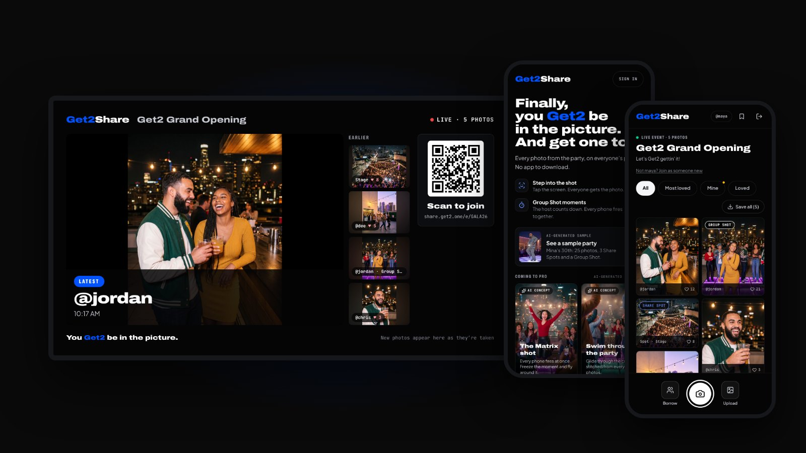
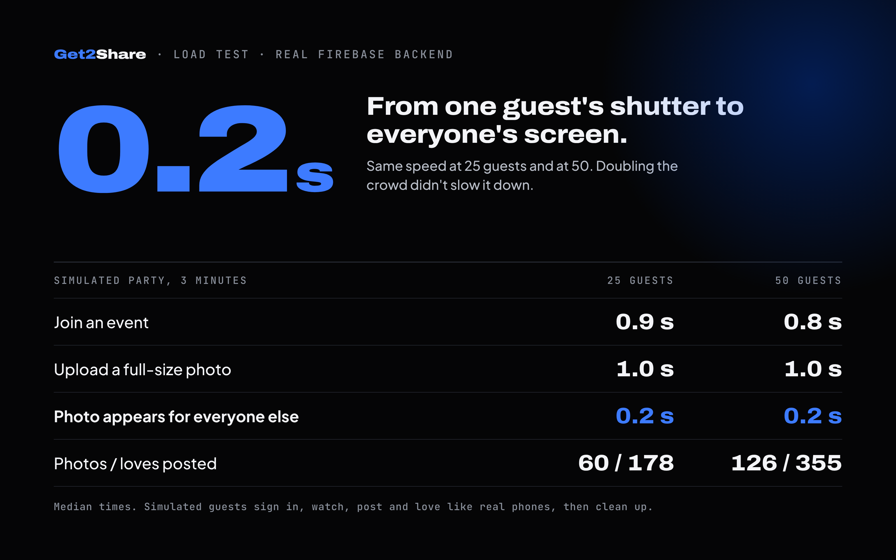

# Get2Share

**You Get2 be in the picture.** A no-app, live event photo-sharing tool that turns every guest's phone into one shared camera system.

**Live:** [share.get2.one](https://share.get2.one) · **Case study:** [get2.one/work/share](https://get2.one/work/share) · **Built by:** [Ron Scott](https://portfolio.get2.one)

## Why it exists

At every event I'd end up in great photos I never got back, or I'd be the one holding the phone for the group shot instead of standing in it. Get2Share puts every photo from the party in one live gallery, and makes sure the person taking pictures gets to be in them too.

## What it does

- **One live gallery.** Guests join by QR code or event code, with nothing to install. Every photo lands in one album everyone sees in real time.
- **Share Spots.** The host turns spare phones or tablets into stationary cameras. Guests see each spot on their own phone, check it's free, and fire the shot with a countdown. Walk-up guests can tap the Share Spot screen and scan a QR code to keep the photo.
- **Borrow.** A guest can ask another guest to lend their camera for a shot, with a live preview, and the photo is credited to both. Off by default; the host turns it on.
- **TV portal.** The gallery plays on a smart TV so the whole room watches photos land.
- **Host controls.** Photo review or auto-approve, and save settings: guests can always save their own photos, and the host decides when guests can save the rest of the album.

## Tested, not just built

**Load test.** [`loadtest/`](loadtest) fills a real event with simulated guests who sign in, watch the gallery, post full-size photos and react, then clean up after themselves.

It also surfaced two scaling findings: reactions drove 73% of database reads (they grow with the square of the crowd, so there's a known throttling fix), and Firebase's limit of about 100 new sign-ins per hour per network is a real risk on shared venue Wi-Fi.

**Usability testing.** Scripted think-aloud sessions changed the product: a bigger close button, swipe-back that closes a photo instead of leaving the event, separate Camera and Upload buttons, and one "Love" reaction instead of thumbs up/down.

**Screenshot harness.** [`harness/`](harness) runs the app against a fake Firebase so any screen can be captured at any size without touching real data.

## How it's built

React 19 · TypeScript · Vite · Tailwind · Firebase (Firestore, Storage, Auth) · Vercel

Prototyped in Emergent, rebuilt in Google AI Studio, then moved off AI Studio to build with Claude. It now runs on Vercel with its own Firebase project. Every feature ships on a preview branch first and goes to `main` (the live site) only after it's tested on real phones.

**Next:** premium video effects and video capture. Payments aren't built yet.

Photos in the screenshots are AI-generated samples; the app screens are real.

## Run locally

Prerequisite: Node.js

1. `npm install`
2. `npm run dev`

## Security model

Get2Share runs many events at once, each sealed off from the others.

- **Routes:** `/` landing (join by code or host your own) · `/e/CODE` an event's join link · `/host` sign in, your events, create one · `/host/EVENTID` Host Console · `/spot` set up a Share Spot.
- **Guests and Share Spots** sign in silently with Firebase **anonymous** auth; the uid is their ID.
- **Hosts** sign in with **Google**. Anyone with an account can create an event and becomes its owner and host. `adminEmails()` in `firestore.rules` (mirrored in `src/hosts.ts`) can help with any event.
- **Data:** `events/{id}` with `members`, `photos`, `sessions`, `live/console` under it; `joinCodes/{CODE}` maps a code to its event; `spotPairings/{CODE}` are one-time Share Spot codes tied to one event.
- `firestore.rules` enforces it server-side:
  - You only see an event's photos if you joined it with its current join code, or host it.
  - Only that event's hosts moderate, change settings, see devices and previews, ask for cameras, fire shutters, or add Share Spots.
  - A guest photo goes live immediately only if auto-approval is on, or a host fired that device's shutter in the last 2 minutes. Otherwise it is `pending`.
  - A host can make a new join link at any time; the old one stops working, and people already in stay in.
  - Share Spots join only by claiming a one-time code from the Host Console (claimed within 10 minutes, once).
- `storage.rules`: each device uploads only into `photos/<its uid>/`, images up to 5 MB.

## One-time Firebase setup

In the [Firebase console](https://console.firebase.google.com/) for the app's project (configured in `src/firebase-config.ts`):

1. **Authentication → Sign-in method**: enable **Anonymous** and **Google**.
2. **Authentication → Settings → Authorized domains**: add the site's domain (and any preview domain you test on).
3. **Firestore → Rules**: paste in `firestore.rules` and click **Publish** whenever that file changes.
4. **Storage → CORS** (once): lets the app read photo files so guests can save them to their devices
   ("Save to this device", "Save all"). In Google Cloud Shell, upload `cors.json` and run:
   `gcloud storage buckets update gs://get2share.firebasestorage.app --cors-file=cors.json`.
   Without it, saving falls back to opening the photo so the guest can press and hold it.

## Changing hosts

Edit the email list in both `firestore.rules` and `src/hosts.ts`, then redeploy the rules.
